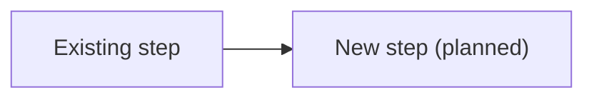

# Proposed Diagram — [Diagram title]

| Field | Value |
|---|---|
| **Diagram ID** | [feature ID plus a number, e.g. FD-0001-D1] |
| **Feature** | [feature ID, with a relative link to its specification] |
| **Status** | <kbd>PROPOSED</kbd> |
| **Copied from** | [source diagram ID, with a link to its document and heading, or "new diagram"] |
| **Base commit** | [the commit the copy was taken from, or "n/a"] |

> **Evidence status legend:** ✅ **VERIFIED** = confirmed in the current repository (cite the source) · 🔷 **PROPOSED** = design or planned change · ❔ **UNKNOWN** = not yet determined
>
> **PROPOSED diagram**, not the implemented system. Copy this file into a `diagrams/` folder next to the feature and link it from the feature's "Proposed diagrams" section. Keep the metadata at the top and this table in step.

## Question this diagram answers

[One sentence: what the reader should understand from this diagram]

## Diagram

## What this diagram does not show

- [For example: exact parameters, performance, error handling]
