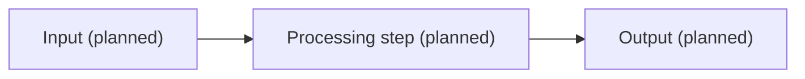

# Feature Specification — {{title}}

<!-- summary:start · generated from the metadata above by New Feature and `python -m tools.design index`; edit the metadata, not this table -->
| Field | Value |
|---|---|
| **Feature ID** | `{{feature_id}}` |
<!-- summary:end -->

> **Evidence status legend:** ✅ **VERIFIED** = confirmed in the current repository (cite the source) · 🔷 **PROPOSED** = design or planned change · ❔ **UNKNOWN** = not yet determined
>
> This is a proposed design, not the implemented system. The current system is described in [docs/architecture]({{architecture}}/); see the [evidence classifications]({{designs}}/README.md#evidence-classifications).

## 1. Objective

- **Problem:** [Describe the real problem to be solved]
- **Users:** [Who needs the result?]
- **Desired outcome:** [Measurable or observable result]

## 2. Data contract

- **Sources:** [Verified source systems, datasets or endpoints, with evidence]
- **Fields:** [Key fields and types; map them in the table below]
- **IDs:** [Primary keys, join keys or unique identifiers]
- **Geometry:** [Geometry type(s) and format, if applicable]
- **CRS:** [Coordinate reference system, if applicable]
- **Limits and refresh:** [Record limits, pagination, update frequency]
- **Outputs:** [What this feature produces]
- **Unknowns / to be confirmed:** [Open data questions or gaps]

**Field mapping (source → database)**

| Source field | Database field | Type, CRS or limit | Evidence | Status |
|---|---|---|---|---|
| [source field] | [database field] | [type] | [path or URL] | ❔ UNKNOWN |

## 3. Logic

- **Processing steps:** [Describe the ETL, transformation or application logic]
- **Assumptions:** [What must hold for the logic to be correct]
- **Example:** [A small input and its expected output]

<b>Proposed diagram (Mermaid)</b>

## 4. Dependencies

### System components

*ETL, database tables, APIs, UI. Use reads_from, writes_to, calls, exposes or renders only when the evidence supports it; label optional or conditional dependencies.*

| Component | Relationship | Reference | Evidence status |
|---|---|---|---|
| — | — | — | — |

### Related features

*Other Orlando features. Prerequisites are declared once, in `depends_on` in the metadata above; the rows between the markers, including the reverse "Used by" rows, are generated from those lists by `python -m tools.design index`. Do not edit them by hand.*

<!-- related-features:start · generated from depends_on by `python -m tools.design index`; do not edit by hand -->
| Feature | Relationship | Reference | Evidence status |
|---|---|---|---|
| — | — | — | — |
<!-- related-features:end -->

## 5. Downstream impact

*A dependency is a reason to investigate, not proof that something must change.*

- **Confirmed affected:** [Components, data or features that will be modified]
- **Potentially affected:** [Items that may be impacted, with the reason]
- **Unknown:** [Areas that require further investigation]

## 6. Acceptance criteria

- [ ] **Verifiable result:** [What must be true when complete] (evidence: [what proves it])
- [ ] **Tests:** [Unit, integration, data or manual tests]
- [ ] **Edge cases:** [Important scenarios to validate, e.g. limits, pagination, empty results]
- [ ] **Performance:** ❔ UNKNOWN unless measured; do not invent numbers

---

<b>Architecture references</b>

Keep the documents and headings this feature builds on (link to a heading with `#anchor`), delete the rest, and list their repository paths in `architecture_refs` above.

- [System architecture]({{architecture}}/system-architecture.md)
- [Data contracts]({{architecture}}/data-contracts.md)
- [Database schema]({{architecture}}/database-schema.md)
- [ETL workflow]({{architecture}}/etl-workflow.md)
- [System overview]({{architecture}}/system-overview.md)
- [Conventions]({{architecture}}/conventions.md)

<b>Proposed diagrams</b>

- [none yet] Create one from {{templates}}/diagram.md in a `diagrams/` folder next to this file and link it here.

