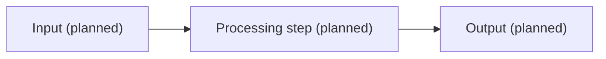

# {{title}}

> **Design document: PROPOSED, not the implemented system.** The current system is
> described in [docs/architecture]({{architecture}}/). Tag every claim **VERIFIED** (with
> its source), **PROPOSED** or **UNKNOWN**; see
> [evidence classifications]({{designs}}/README.md#evidence-classifications).

## Architecture references

<!-- Keep the documents and headings this feature builds on, link to headings with #anchor,
     delete the rest. Also list their repository paths in architecture_refs above. -->

- [System architecture]({{architecture}}/system-architecture.md)
- [Data contracts]({{architecture}}/data-contracts.md)
- [Database schema]({{architecture}}/database-schema.md)
- [ETL workflow]({{architecture}}/etl-workflow.md)
- [System overview]({{architecture}}/system-overview.md)
- [Conventions]({{architecture}}/conventions.md)

## 1. Objective

<!-- What real problem is solved? Who needs the result? What measurable or observable
     outcome is required? Link to evidence; do not invent use cases. -->

- **Problem:** UNKNOWN
- **Who needs the result:** UNKNOWN
- **Observable outcome:** UNKNOWN

## 2. Data contract

<!-- Source systems, endpoints, fields, types, IDs, geometry types, coordinate systems,
     limits, refresh behaviour, required outputs and unknowns. Record the evidence path or
     URL and any test or sample confirming each claim. Keep source fields separate from
     normalized database fields. -->

| Item | Source field | Database field | Type, CRS or limit | Evidence | Status |
|---|---|---|---|---|---|
| _item_ | _source field_ | _database field_ | _type_ | _path or URL_ | UNKNOWN |

## 3. Logic

<!-- Processing sequence, SQL and spatial operations, assumptions, expected inputs and
     outputs, and small testable examples. Proposed logic is not running code. -->

## 4. Dependencies

### System components

<!-- Real tables, code, endpoints or documents this feature touches. Use reads_from,
     writes_to, calls, exposes or renders only when the evidence supports it, and label
     optional or conditional dependencies. -->

| Component | Relationship | Reference | Evidence status |
|---|---|---|---|
| _component_ | _relationship_ | _relative link to the table, code or document_ | PROPOSED |

### Related features

<!-- Feature prerequisites are declared once, in depends_on in the metadata block at the
     top (feature IDs). Do not list them by hand here: Phase 2 generates these rows from
     depends_on, including the reverse "used by" rows. -->

| Feature | Relationship | Reference | Evidence status |
|---|---|---|---|
| _generated from depends_on_ | depends_on | _feature ID and relative link_ | PROPOSED |

## 5. Downstream impact

<!-- A dependency is a reason to investigate, not proof that something must change. -->

### Confirmed affected

- _none yet_

### Potentially affected

- _none yet_

### Unknown

- _none yet_

## 6. Acceptance criteria

<!-- Verifiable expected results, correctness checks, edge cases, API limits and
     pagination where relevant, performance expectations, tests and the evidence required.
     Mark unknown benchmarks UNKNOWN; do not invent numbers. -->

- [ ] _criterion_ (evidence required: _what proves it_)

## Proposed diagrams

<!-- Create proposed diagrams from {{templates}}/diagram.md in a diagrams/ folder next to
     this file and link them here. -->

- _none yet_
