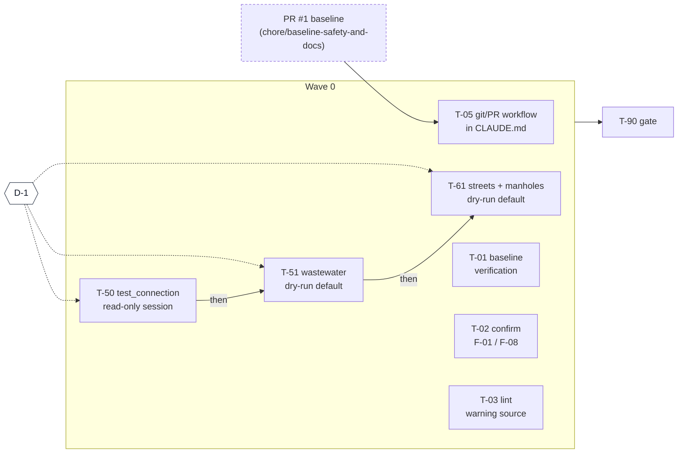
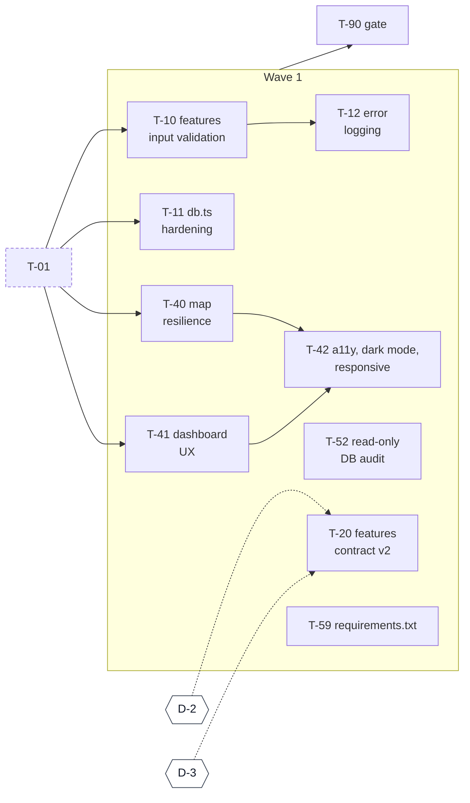
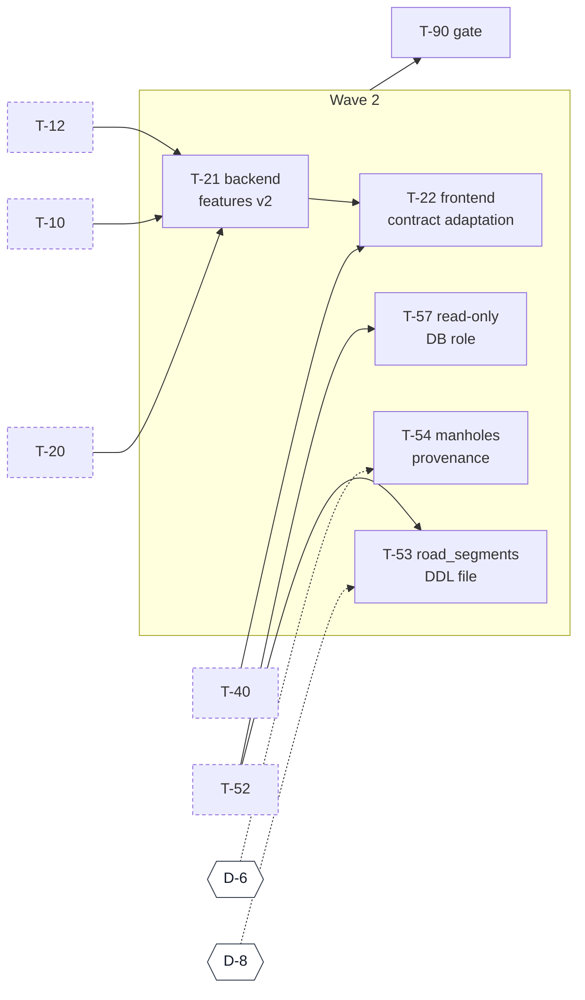
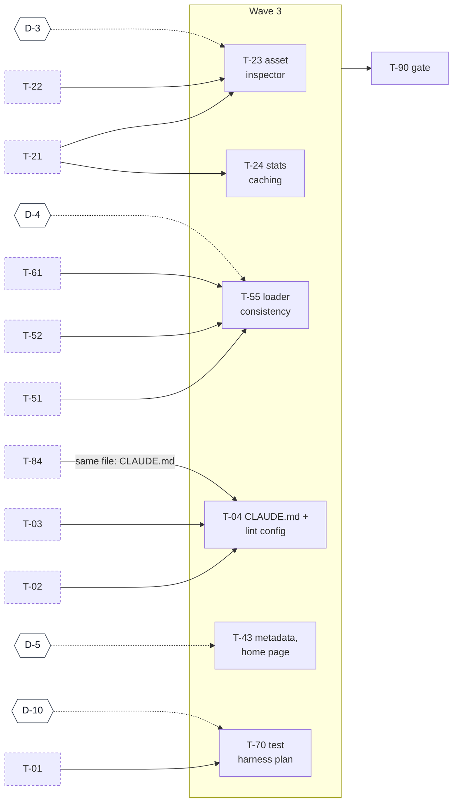
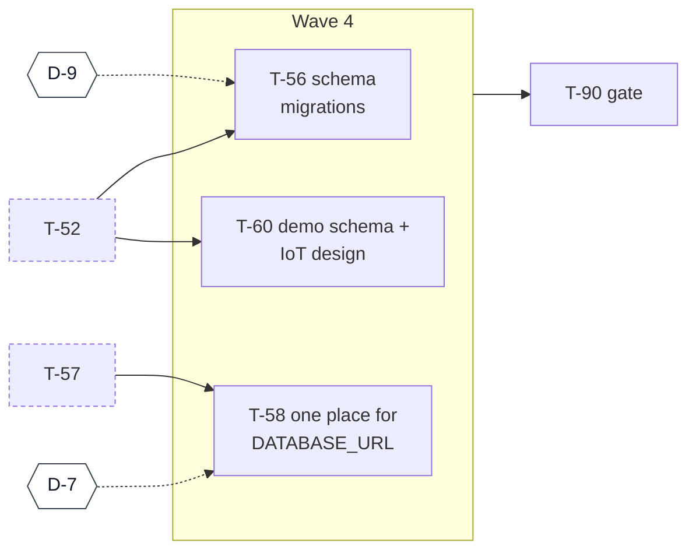
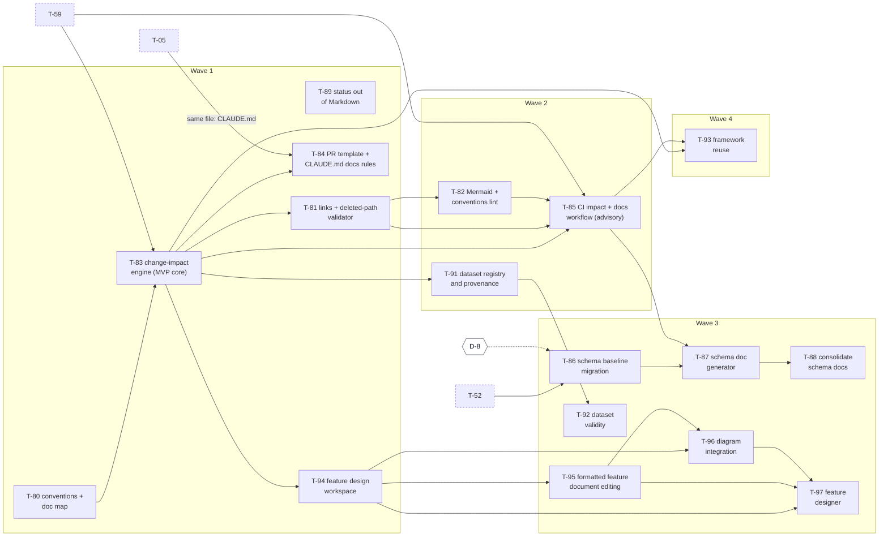
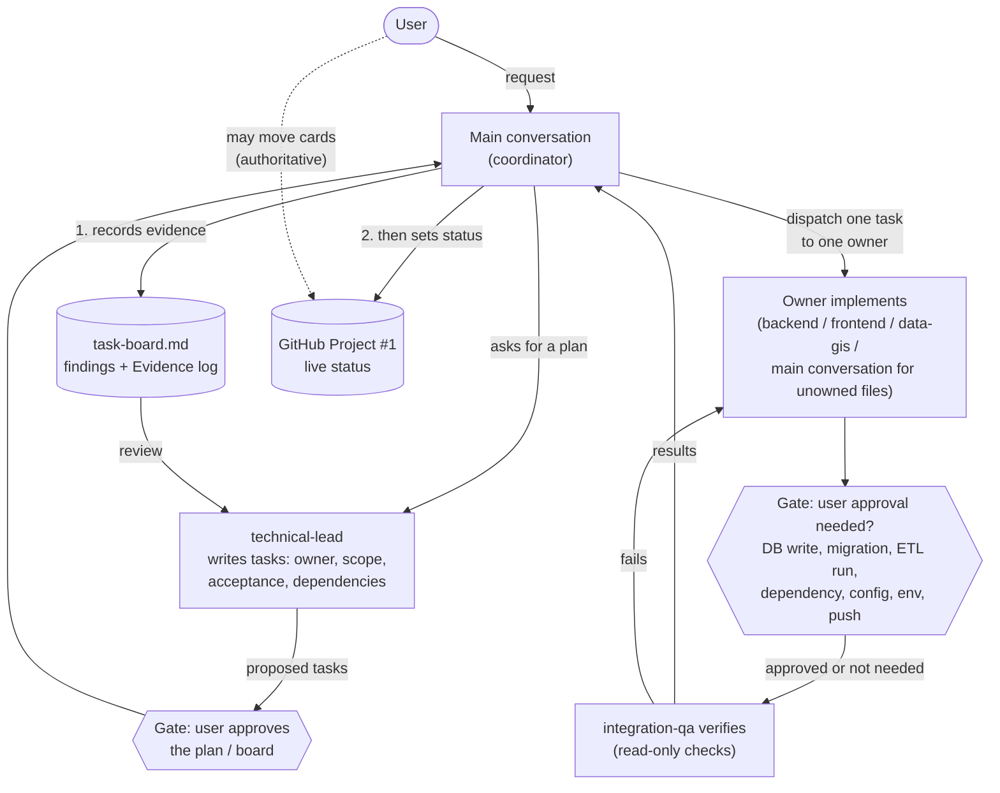

# Task Dependencies and Waves

> **Dependencies and waves come from the task cards in
> [GitHub Project #1](https://github.com/users/adrianfarhat/projects/1) (private),
> which are authoritative.** These diagrams are a navigation view derived from the
> cards. They do not track status. If a diagram disagrees with a card, the card
> wins; fix this page. (The filename is kept because other pages link to it.)

Links to every card are in the [Task index](task-board.md#task-index).
Verification evidence is in the task board's [Evidence log](task-board.md#evidence-log).

## 1. Tasks by wave

Key: **rectangle** = a task in this wave · **dotted rectangle** = a prerequisite
from another wave or from outside the board, such as PR #1 (a dependency, not a
status) · **hexagon** = a decision
(D-x) · solid arrow = task dependency · dotted arrow = depends on a decision.
Arrows point from a prerequisite to the task that needs it. Every wave ends with
the T-90 verification gate. Each wave's T-90 gate also covers the documentation-synchronization tasks in that wave, which are shown in their own diagram below. Colours and styles here never show status.

### Wave 0: safety and baseline

T-50, T-51 and T-61 go ahead with per-change user approval under D-1 option (a).
The 'then' arrows (T-50 → T-51 → T-61) show the order the tasks are edited in. They are not dependencies on the Project cards.

### Wave 1: fixes with no contract change

### Wave 2: contract v2

### Wave 3: features and hygiene

### Wave 4: needs approval or architecture work

Never run two tasks at the same time on `web/src/components/InfrastructureMap.tsx`, `web/src/app/api/infrastructure/features/route.ts`, `CLAUDE.md` (in order: T-05, T-84, T-04) or the same loader.

## 2. Documentation and change-impact framework (T-80 to T-93)

Plan approved by the user 2026-11-17; T-91 to T-93 added 2026-11-18. These tasks
use the same Wave field as the rest of the board (waves 1–4); each subgraph below
is one wave. Dotted rectangles are prerequisites from the wave diagrams above.
T-59 appears in the Wave 1 diagram above and is a prerequisite of T-83 and T-85
here. T-94 (Feature Design Workspace, added 2026-11-20) builds on T-83 and is shown
in its Wave 1 subgraph; its follow-ups T-95 (formatted feature document editing)
and T-96 (diagram integration, which also depends on T-95), added 2026-11-21, are
in Wave 3, as is T-97 (Feature Designer, added 2026-11-21, which depends on T-94,
T-95 and T-96). Card links: [Task index](task-board.md#task-index).

T-93 also requires the MVP (T-83) to be demonstrated through several real feature PRs before it starts; that condition is on the T-93 card and cannot be drawn as a dependency arrow.

T-86 overlaps T-53 (the `road_segments` DDL file); whether T-53 is closed as
superseded is the user's decision.

## 3. Decisions and what they block

The diagrams above show which tasks each decision blocks (dotted arrows from a
hexagon). Each decision's question, options, recommendation and live state are on
its D-xx card; see the [Task index](task-board.md#task-index). Outcomes, once made,
are recorded under [Decisions](task-board.md#decisions) on the task board.

Other prerequisites that are not decisions:

| Prerequisite | What depends on it |
|---|---|
| User approval for one live read-only Neon run of `database/test_connection.py` | The last T-50 acceptance check |
| A running dev server for T-01 (the user may need to start it) | T-01, and through it T-10, T-11, T-40, T-41, T-70 |

Verification results are in the task board's
[Evidence log](task-board.md#evidence-log).

## 4. How work flows through the team

- Only the owner of a file edits it, and only one task edits a file at a time
  (CLAUDE.md, *Agents and file ownership*).
- A card moves to Done in Project #1 only after its verification results are
  recorded on the task board (CLAUDE.md, rule 10). Only the main conversation
  changes the Project; the user may also move cards directly.
