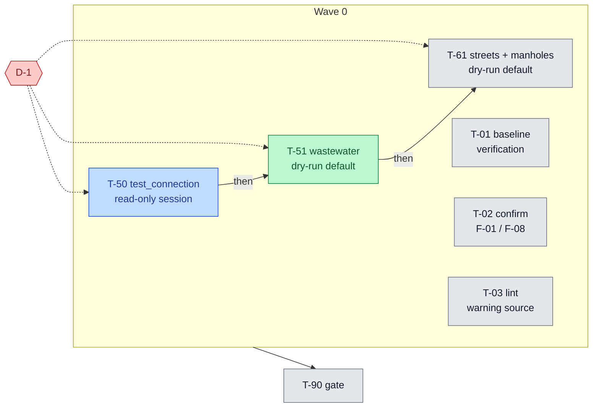
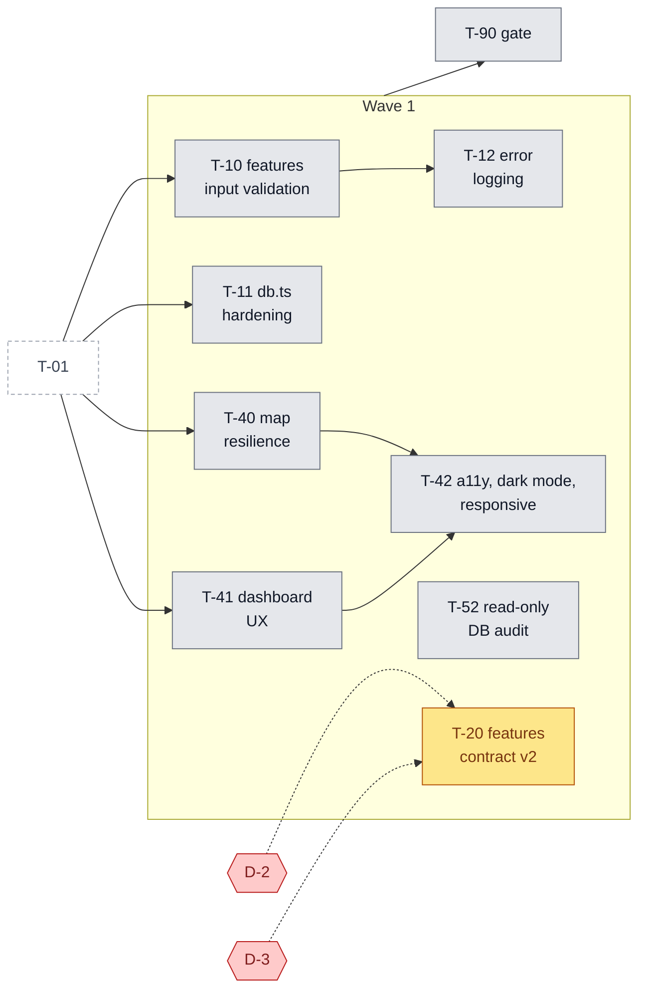
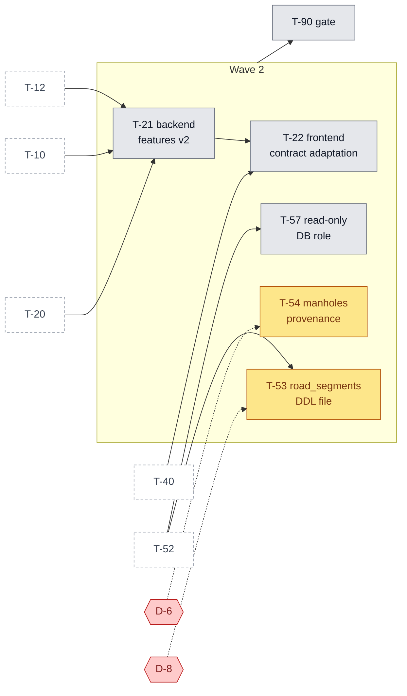
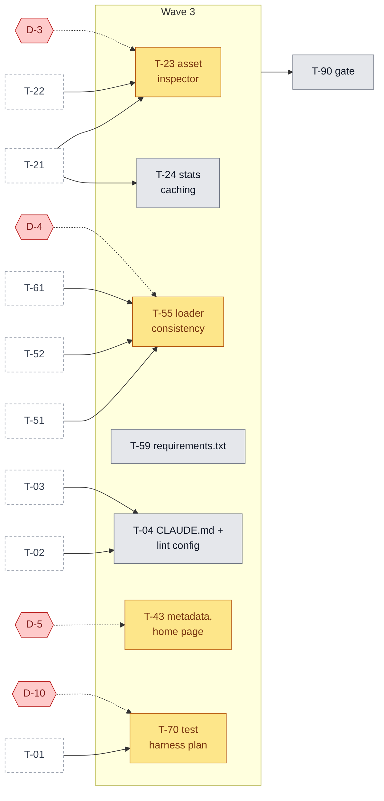
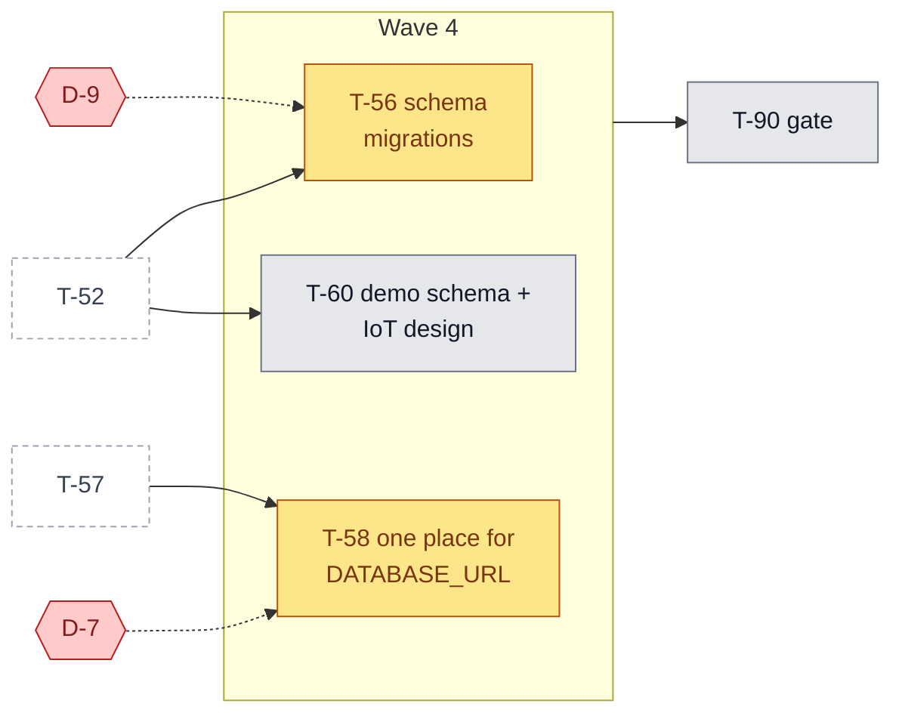
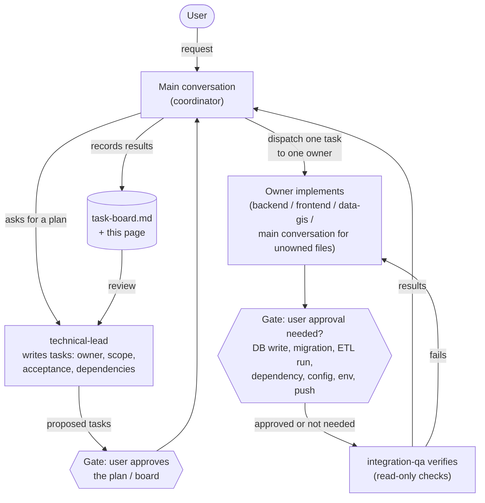

# Development Status

> Derived from [task-board.md](task-board.md) (source of truth). Updated in the
> same edit as any status change. Last updated: 2026-11-17.

This page is a dashboard view of the board. If it disagrees with the board, the
board wins; fix this page. Acceptance criteria and full verification results live
only on the board, and this page links to them.

## 1. Status at a glance

| Status | Tasks | Count |
|---|---|---|
| Done | T-51 | 1 |
| In progress | T-50 (waiting for user approval of one live read-only run) | 1 |
| Not started, waiting on a pending decision | T-20, T-23, T-43, T-53, T-54, T-55, T-56, T-58, T-70 | 9 |
| Not started, no decision needed | T-01, T-02, T-03, T-04, T-10, T-11, T-12, T-21, T-22, T-24, T-40, T-41, T-42, T-52, T-57, T-59, T-60, T-61 (D-1 pending; proceeds with per-change user approval, as T-50/T-51), T-90 | 19 |
| Blocked | none | 0 |
| **Total** | | **30** |

"Waiting on a pending decision" is a view on this page, not a board status. On
the board these tasks are `Not started` and depend on one of D-1 to D-10.

### By owner

| Owner | Done | In progress | Not started | Total |
|---|---|---|---|---|
| main conversation (user approval) | 1 (T-51) | 1 (T-50) | 6 (T-04, T-53, T-55, T-58, T-59, T-61) | 8 |
| integration-qa | 0 | 0 | 5 (T-01, T-02, T-03, T-70, T-90) | 5 |
| backend | 0 | 0 | 5 (T-10, T-11, T-12, T-21, T-24) | 5 |
| frontend | 0 | 0 | 6 (T-22, T-23, T-40, T-41, T-42, T-43) | 6 |
| data-gis | 0 | 0 | 4 (T-52, T-54, T-56, T-57) | 4 |
| technical-lead | 0 | 0 | 2 (T-20, T-60) | 2 |

T-54 is shared: data-gis does the check, then technical-lead updates the docs.
T-56 and T-57 are proposed by data-gis and applied by the user. Each is counted
once, under its first owner.

## 2. Tasks by wave

Colour key: **green** Done · **blue** In progress · **grey** Not started ·
**amber** Not started and waiting on a decision · **red hexagon** pending decision
· dotted box: a task from an earlier wave. Arrows point from a prerequisite to the
task that needs it. Every wave ends with the T-90 verification gate.

### Wave 0: safety and baseline

T-50 and T-51 were applied by the main conversation with user approval, while D-1
is still formally pending.

### Wave 1: fixes with no contract change

### Wave 2: contract v2

### Wave 3: features and hygiene

### Wave 4: needs approval or architecture work

## 3. Blockers and pending decisions

All ten decisions are **PENDING**. Options and recommendations are on the
[task board](task-board.md#decisions).

| Item | What it is | What it blocks |
|---|---|---|
| D-1 | Who edits `database/` and `extractors/` | Formally T-50 and T-51, which went ahead with per-change user approval. T-61 also depends on D-1. Becomes critical for the product vision, where most new work is SQL and data. |
| D-2 | `/features` limits (bbox cap, order, rounding) | T-20 → T-21 → T-22, T-23 |
| D-3 | Asset inspector data shape | T-20, T-23 |
| D-4 | Loader policy (null geometry, DDL) | T-55, and the DDL item deferred from T-51 |
| D-5 | What `/` shows | T-43 |
| D-6 | ArcGIS metadata GET | T-54 |
| D-7 | Where `DATABASE_URL` lives | T-58 |
| D-8 | Path of the DDL file | T-53 |
| D-9 | Whether to do schema migrations | T-56 |
| D-10 | Test runner | T-70 |
| User approval | One live read-only Neon run of `database/test_connection.py` | Closing T-50 |
| Environment | T-01 needs a running dev server (the user may need to start it) | T-01, and through it T-10, T-11, T-40, T-41, T-70 |

## 4. Latest verification results

| Date | Task | Result | Details |
|---|---|---|---|
| 2026-11-16 | T-51 | **Done.** All checks pass with no Neon access. | [Task board → T-51](task-board.md#t-51-wastewater-loader-writes-nothing-by-default-p0) |
| 2026-11-16 | T-50 | Code checks pass; the live read-only run is pending approval | [Task board → T-50](task-board.md#t-50-test_connectionpy-read-only-session-p0) |
| 2026-11-16 | none (team inspection) | Run by integration-qa during the inspection, not yet recorded against a task: `tsc --noEmit` passes; lint 0 errors / 1,103 warnings, cause unknown (`.next/**` is already ignored). T-01 and T-03 will re-run and record. | [Task board findings](task-board.md#findings-from-the-2026-11-16-repository-inspection) |

## 5. How work flows through the team

- Only the owner of a file edits it, and only one task edits a file at a time
  (CLAUDE.md, *Agents and file ownership*).
- A task is `Done` only when its verification results are recorded on the board
  (CLAUDE.md, rule 10).
