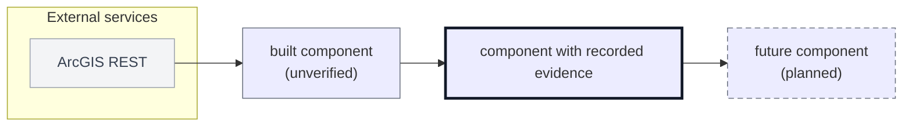

# Documentation Conventions

Rules for how this project's docs show the system, which source is authoritative
for what, and how docs change alongside code. Introduced by T-80 (2026-11-17).

- Live **task** status is in [GitHub Project #1](https://github.com/users/adrianfarhat/projects/1) (private),
  never in Markdown. Scope, acceptance criteria and evidence are on the
  [task board](../agents/task-board.md).
- The code-path → doc mapping used to find docs affected by a change is in
  [doc-map.yml](../doc-map.yml).
- Related pages: [system-architecture.md](system-architecture.md),
  [system-overview.md](system-overview.md), [etl-workflow.md](etl-workflow.md),
  [database-schema.md](database-schema.md), [data-contracts.md](data-contracts.md).

## 1. Implementation-status legend

This legend describes the **system**: whether a component is built, whether that
has been verified, or whether it is only planned. It never describes task status.

| Class | Meaning | Border | Label | Grouping |
|---|---|---|---|---|
| `verified` | Built, and verification evidence is recorded on the [task board](../agents/task-board.md#evidence-log) | Solid, thick | No suffix | — |
| `unverified` | Built, but no recorded verification | Solid, thin | Ends with `(unverified)` | — |
| `planned` | Not built | Dashed | Ends with `(planned)` | — |
| `external` | Not ours: City of Orlando ArcGIS, OpenFreeMap, Neon as a service | Solid, grey fill | No suffix | In a subgraph whose title starts with "External" when a diagram has several external nodes; a single external node may stand alone with the class |

A service is classed `external`; the data or schema we own inside it (for example our three tables in Neon) is classed separately, as `unverified` or `verified`.

Copy these lines exactly into every architecture or component diagram (unused
classes may stay; they cost nothing):

```text
  classDef verified stroke:#111827,stroke-width:3px
  classDef unverified stroke:#6b7280,stroke-width:1px
  classDef planned stroke:#6b7280,stroke-width:1px,stroke-dasharray:6 4
  classDef external fill:#f3f4f6,stroke:#9ca3af,color:#374151
```

Then assign nodes with `class A,B,C unverified` (and so on).

Put this legend line in the Markdown directly above the diagram (or "Legend: as in
section N" when an earlier diagram on the same page has it):

```text
Legend (conventions.md): thick solid border = verified · thin solid border + "(unverified)" = built, no recorded verification · dashed border + "(planned)" = not built · grey, in an "External" group = not ours.
```

Example:



Rules:

- **A component becomes `verified` only when its evidence is recorded** on the task
  board (under the task and in the Evidence log). Code existing, a passing type
  check or a documented baseline query is not enough on its own.
- Verification is about the component as drawn. If a node bundles several things
  and only part is verified (for example one loader's dry-run gate), the node stays
  `unverified`.
- Every architecture diagram carries the legend line.
- **Colour must never encode task status.** No green "done", amber "waiting" and so
  on, in any diagram. Status belongs only in Project #1.
- People and the browser (actors) are not components and take no class. Open
  questions drawn as hexagons are not components either.
- The suffix and the border must agree. A reader without colour or a renderer must
  still get the meaning from the label.

## 2. Diagram types

| Type | Examples | Legend applies? | Rule |
|---|---|---|---|
| Architecture / component | System big picture, credential boundary, inside the web app, target state | **Yes** | Every component node gets a class and, if not `verified` or `external`, a suffix |
| Process / flow | Loader flowcharts, safety gates, SQL workflow, team workflow | No | Must not show a planned step as if it were built: mark it "(planned)" in the label |
| Sequence | One map pan | No | Shows built behaviour only; planned behaviour goes in prose or a separate diagram |
| Dependency / wave | Task waves, docs-sync initiative | No | Shows dependencies only. No status colours. Decisions are hexagons (a type, not a status) |
| Data model (ER) | Current and target schema | No | The section heading says built or proposed; spatial relationships follow section 4 |

## 3. Authority map

Which source wins when two disagree.

| Topic | Authoritative source | Notes |
|---|---|---|
| Database schema | The live Neon database today | Target: versioned migrations in the repo (T-86). Docs describe it; they do not define it. |
| ETL behaviour | `extractors/*.py` | [etl-workflow.md](etl-workflow.md) explains the code |
| API contract meaning | [data-contracts.md](data-contracts.md) | A contract change is its own task, done here first (CLAUDE.md rule 5) |
| API implementation | `web/src/app/api/**` | Must match the contract; a mismatch is a bug in one of them |
| Coded-value labels | `web/src/app/api/infrastructure/stats/route.ts` | Docs copy the labels from there (data-contracts.md differs today; T-20 fixes it) |
| UI behaviour | `web/src/components/**` | |
| Task status | [GitHub Project #1](https://github.com/users/adrianfarhat/projects/1) (private) | Never in Markdown |
| Verification evidence | Task board [Evidence log](../agents/task-board.md#evidence-log) and each task's results | Required before a card moves to Done |
| Generated docs | Their generator | Never hand-edited. None exist yet (planned: `docs/architecture/generated/`) |

## 4. Spatial relationships are not foreign keys

The three `public` tables have no foreign keys (unverified for `road_segments`: from the 2026-11-16 baseline; its DDL is not in the repo. For the other two, the loader DDL defines none). Roads, pipes and manholes relate
only through geometry, computed at query time.

- **Never draw a spatial relationship as a foreign-key line**, in an ER diagram or
  anywhere else.
- Document each spatial relationship separately with:
  - **method** (for example `ST_DWithin`, buffer overlap, KNN `<->`);
  - **parameters** (buffer distance and units, SRID or `::geography`, tie-breaking);
  - **status** (implemented, or planned and under which task);
  - where the result is stored, if it is materialized (for example a planned
    `analysis` table with a `run_id`).
- A materialized link table may hold real foreign-key columns pointing at its own
  inputs. Its diagram must still say that the link was computed, and by which method.

## 5. Branch docs workflow

1. Docs change **on the feature branch, in the same branch as the code** they
   describe. Use [doc-map.yml](../doc-map.yml) to find the affected docs.
2. Preview locally (VS Code Markdown preview with Mermaid support) or in a draft PR.
3. Docs reach `main` **only at merge**, after user approval. Nothing is published
   separately.
4. The PR description has a **Documentation impact** section: which docs changed,
   or "no change needed" with a reason.
5. Implementation-status labels must be honest **at merge time**: a component
   becomes `verified` only if its evidence is recorded by then.

## 6. Line references

- Prefer symbol or function names (`get_ids()`, `main()`, the `tables` allowlist).
  They survive edits.
- Use `#Lx-Ly` links only where precision matters (a specific check or a security
  gate), and re-check them when the file changes.

## 7. Diagram classification

Every Mermaid block in `docs/` as of 2026-11-17 (T-80). Line numbers are
approximate.

| File | Line | Diagram | Type | Legend? | Decision |
|---|---|---|---|---|---|
| architecture/system-architecture.md | ~27 | §1 Current state: big picture | Architecture | **Y** | Applied. ETL, RAW, 3 tables, pool, API, UI → `unverified`; ArcGIS, OpenFreeMap → `external` (already in the "External services" subgraph); browser = actor, no class |
| architecture/system-architecture.md | ~83 | Credential boundary | Architecture | **Y** | Applied. Env files, role, loaders + test_connection, Next.js server → `unverified`; Neon database → `external` (single node, no subgraph added) |
| architecture/system-architecture.md | ~128 | §2 Inside the web app | Architecture | **Y** | Applied. All 9 app/data nodes → `unverified`; OpenFreeMap → `external` |
| architecture/system-architecture.md | ~178 | §3 One map pan | Sequence | N | Exempt. Shows built behaviour only; no change |
| architecture/system-architecture.md | ~256 | §4 Target state | Architecture | **Y** | Applied. 3 real tables → `unverified`; all planned nodes → `planned`, with "(planned)" added to the 7 labels that lacked it (A1, A2, S1–S5); the old one-off `planned` classDef replaced by the standard lines; OPEN hexagon = question, no class |
| architecture/etl-workflow.md | ~29 | Common pattern | Process | N | Exempt. Generic; the caption says which steps a loader lacks; no change |
| architecture/etl-workflow.md | ~51 | Streets loader | Process | N | Exempt; no change |
| architecture/etl-workflow.md | ~75 | Wastewater loader | Process | N | Exempt; no change |
| architecture/etl-workflow.md | ~105 | Manholes loader | Process | N | Exempt; no change |
| architecture/etl-workflow.md | ~139 | Safety gates | Process | N | Exempt: it shows decisions and paths, not components. No change. See open question on the T-51 dry-run path |
| architecture/database-schema.md | ~18 | Current model (ER) | Data model | N | Exempt; heading says built. No relationships drawn; no change |
| architecture/database-schema.md | ~98 | Target model (ER) | Data model | N | Exempt; heading says proposed. **Needs review against section 4**: computed links are drawn as plain ER relationships (listed for a later task, not changed here) |
| architecture/database-schema.md | ~186 | SQL team workflow | Process | N | Exempt; no change |
| architecture/conventions.md | ~48 | Legend example | Example | **Y** | New, demonstrates the four classes |
| agents/development-status.md | ~22 | Wave 0 | Dependency | N | Status classes (done/progress/todo) removed; decisions kept as neutral hexagons; T-05 added, with PR #1 as a dotted prerequisite |
| agents/development-status.md | ~55 | Wave 1 | Dependency | N | Status classes (todo/waiting) removed; prior-wave nodes kept dotted as `otherwave` |
| agents/development-status.md | ~90 | Wave 2 | Dependency | N | As Wave 1 |
| agents/development-status.md | ~126 | Wave 3 | Dependency | N | As Wave 1 |
| agents/development-status.md | ~173 | Wave 4 | Dependency | N | As Wave 1 |
| agents/development-status.md | ~205 | Documentation synchronization (T-80 to T-89) | Dependency | N | New: T-80 to T-89 with prerequisites T-05, T-03, T-52, T-59 and D-8 |
| agents/development-status.md | ~285 | Team workflow | Process | N | Updated: Project #1 sets status, task-board.md records evidence; `TB` node already renamed `BOARD` |

Nothing was reclassified as `verified`. Candidates are listed as questions in the
T-80 review, not applied.
