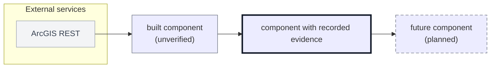

# Documentation Conventions

Rules for how this project's docs show the system, which source is authoritative
for what, and how docs change alongside code. Introduced by T-80 (2026-11-17).

- Task status, scope, priority, dependencies and acceptance criteria are on the
  cards in [GitHub Project #1](https://github.com/users/adrianfarhat/projects/1) (private), never copied into Markdown. Findings, decision outcomes and
  verification evidence are on the [task board](../agents/task-board.md). See
  [Where task information lives](#where-task-information-lives).
- The code-path → doc mapping used to find docs affected by a change is the
  component registry, [registry/components.yml](../../registry/components.yml),
  configured by [impact.yml](../../impact.yml). See [section 5](#5-branch-docs-workflow).
- Related pages: [system-architecture.md](system-architecture.md),
  [system-overview.md](system-overview.md), [etl-workflow.md](etl-workflow.md),
  [database-schema.md](database-schema.md), [data-contracts.md](data-contracts.md).

## 1. Implementation-status legend

This legend describes the **system**: whether a component is built, whether that
has been verified, or whether it is only planned. It never describes task status.

| Class | Meaning | Border | Label | Grouping |
|---|---|---|---|---|
| `verified` | Built, and verification evidence is recorded on the [task board](../agents/task-board.md#evidence-log) | Solid, thick | No suffix | — |
| `unverified` | Built, but no recorded verification | Solid, thin | Ends with `(unverified)` | — |
| `planned` | Not built | Dashed | Ends with `(planned)` | — |
| `external` | Not ours: City of Orlando ArcGIS, OpenFreeMap, Neon as a service | Solid, grey fill | No suffix | In a subgraph whose title starts with "External" when a diagram has several external nodes; a single external node may stand alone with the class |

A service is classed `external`; the data or schema we own inside it (for example our three tables in Neon) is classed separately, as `unverified` or `verified`.

Copy these lines exactly into every architecture or component diagram (unused
classes may stay; they cost nothing):

```text
  classDef verified stroke:#111827,stroke-width:3px
  classDef unverified stroke:#6b7280,stroke-width:1px
  classDef planned stroke:#6b7280,stroke-width:1px,stroke-dasharray:6 4
  classDef external fill:#f3f4f6,stroke:#9ca3af,color:#374151
```

Then assign nodes with `class A,B,C unverified` (and so on).

Put this legend line in the Markdown directly above the diagram (or "Legend: as in
section N" when an earlier diagram on the same page has it):

```text
Legend (conventions.md): thick solid border = verified · thin solid border + "(unverified)" = built, no recorded verification · dashed border + "(planned)" = not built · grey, in an "External" group = not ours.
```

Example:



Rules:

- **A component becomes `verified` only when its evidence is recorded** on the task
  board (in the Evidence log). Code existing, a passing type
  check or a documented baseline query is not enough on its own.
- Verification is about the component as drawn. If a node bundles several things
  and only part is verified (for example one loader's dry-run gate), the node stays
  `unverified`.
- Only architecture diagrams (`%% diagram-type: architecture`) carry the legend line and the four standard classDefs. Process, sequence, dependency and ER diagrams do not need them (section 2).
- **Colour must never encode task status.** No green "done", amber "waiting" and so
  on, in any diagram. Status belongs only in Project #1.
- People and the browser (actors) are not components and take no class. Open
  questions drawn as hexagons are not components either.
- The suffix and the border must agree. A reader without colour or a renderer must
  still get the meaning from the label.

## 2. Diagram types

| Type | Marker | Examples | Legend required? | Rule |
|---|---|---|---|---|
| Architecture / component | `architecture` | System big picture, credential boundary, inside the web app, target state | **Yes**: legend line above the block and the four standard classDefs | Every component node gets a class and, if not `verified` or `external`, a suffix |
| Process / flow | `process` | Loader flowcharts, safety gates, SQL workflow, team workflow | No | Must not show a planned step as if it were built: mark it "(planned)" in the label |
| Sequence | `sequence` | One map pan | No | Shows built behaviour only; planned behaviour goes in prose or a separate diagram |
| Dependency / wave | `dependency` | Task waves, docs-sync initiative | No | Shows dependencies only. No status colours. Decisions are hexagons (a type, not a status) |
| Data model (ER) | `er` | Current and target schema | No | The section heading says built or proposed; spatial relationships follow section 4 |
| Example | `example` | The legend example in section 1 | No legend line; the classDefs are checked | Illustrates a convention; not a real diagram |

### Diagram-type marker

Every Mermaid block declares its type on the line directly after the diagram
declaration:

```text
flowchart LR
  %% diagram-type: architecture
```

- Allowed values: `architecture`, `process`, `sequence`, `dependency`, `er`, `example`.
- Exactly one marker per block. A missing, unknown or repeated marker is an error.
- The docs lint (T-82) uses the marker to decide which checks apply:
  - `architecture`: the legend line directly above the block, the four standard
    classDefs, and label suffixes that match the classes;
  - all types: any node in the `planned` class is labelled "(planned)".

## 3. Authority map

Which source wins when two disagree.

| Topic | Authoritative source | Notes |
|---|---|---|
| Database schema | The live Neon database today | Target: versioned migrations in the repo (T-86). Docs describe it; they do not define it. |
| ETL behaviour | `extractors/*.py` | [etl-workflow.md](etl-workflow.md) explains the code |
| API contract meaning | [data-contracts.md](data-contracts.md) | A contract change is its own task, done here first (CLAUDE.md rule 5) |
| API implementation | `web/src/app/api/**` | Must match the contract; a mismatch is a bug in one of them |
| Coded-value labels | `web/src/app/api/infrastructure/stats/route.ts` | Docs copy the labels from there (data-contracts.md differs today; T-20 fixes it) |
| UI behaviour | `web/src/components/**` | |
| Task status, scope, priority, dependencies, acceptance criteria | [GitHub Project #1](https://github.com/users/adrianfarhat/projects/1) (private) | Never copied into Markdown; link to the card |
| Findings, decision outcomes, verification evidence | [docs/agents/task-board.md](../agents/task-board.md) ([Evidence log](../agents/task-board.md#evidence-log)) | Versioned in git; evidence is required before a card moves to Done |
| Generated docs | Their generator | Never hand-edited. None exist yet (planned: `docs/architecture/generated/`) |

### Where task information lives

| Where | What it holds |
|---|---|
| [GitHub Project #1](https://github.com/users/adrianfarhat/projects/1) (private) | Task fields: status, scope, priority, wave, dependencies, approvals and acceptance criteria; for decisions, the question, options and recommendation |
| [docs/agents/task-board.md](../agents/task-board.md) | Task index (links only), findings, decision outcomes, risks and the Evidence log |
| [docs/agents/development-status.md](../agents/development-status.md) | Dependency and wave diagrams derived from the Project (a navigation view) |
| `docs/architecture/*.md` | The system: architecture, data contracts, ETL, schema and these conventions |

Do not copy live task fields (status, scope, priority, wave, dependencies, acceptance criteria) into Markdown, except the derived dependency and wave diagrams in development-status.md, which follow the cards. Link to the Project card instead. Evidence and architectural findings stay in Markdown because they must be versioned in git.

Priority scale (Project field): P0 safety or rule violation · P1 correctness or reliability · P2 quality · P3 later or optional.

## 4. Spatial relationships are not foreign keys

The three `public` tables have no foreign keys (unverified for `road_segments`: from the 2026-11-16 baseline; its DDL is not in the repo. For the other two, the loader DDL defines none). Roads, pipes and manholes relate
only through geometry, computed at query time.

- **Never draw a spatial relationship as a foreign-key line**, in an ER diagram or
  anywhere else.
- Document each spatial relationship separately with:
  - **method** (for example `ST_DWithin`, buffer overlap, KNN `<->`);
  - **parameters** (buffer distance and units, SRID or `::geography`, tie-breaking);
  - **status** (implemented, or planned and under which task);
  - where the result is stored, if it is materialized (for example a planned
    `analysis` table with a `run_id`).
- A materialized link table may hold real foreign-key columns pointing at its own
  inputs. Its diagram must still say that the link was computed, and by which method.

## 5. Branch docs workflow

1. Docs change **on the feature branch, in the same branch as the code** they
   describe. To find the affected docs, look up each changed file in
   [registry/components.yml](../../registry/components.yml):
   - The file belongs to the one component whose `paths` (minus `exclude`) match it
     most specifically. A narrower component replaces a broader one; the two lists of
     docs are not combined.
   - Review that component's `docs` in the same branch. `docs: []` means the file
     has no documentation obligation. Regenerate any `generated` docs; never edit
     them by hand. A component marked `planned: true` covers paths that do not exist yet.
   - Also check `content_triggers`. If a changed file matches a trigger's `paths` and
     its content matches the trigger's `match`, review that trigger's `docs` as well.
   - `python -m tools.impact validate` checks the registry and
     [impact.yml](../../impact.yml) against the working tree. It does not analyse a
     branch's changes.
2. Preview locally (VS Code Markdown preview with Mermaid support) or in a draft PR.
3. Docs reach `main` **only at merge**, after user approval. Nothing is published
   separately.
4. The PR description has a **Documentation impact** section: which docs changed,
   or "no change needed" with a reason.
5. Implementation-status labels must be honest **at merge time**: a component
   becomes `verified` only if its evidence is recorded by then.

## 6. Line references

- Prefer symbol or function names (`get_ids()`, `main()`, the `tables` allowlist).
  They survive edits.
- Use `#Lx-Ly` links only where precision matters (a specific check or a security
  gate), and re-check them when the file changes.

## 7. Diagram classification

Every Mermaid block in `docs/` as of 2026-11-17 (T-80). Line numbers are
approximate.
Each block's `%% diagram-type:` marker follows its Type column: Architecture →
`architecture`, Process → `process`, Sequence → `sequence`, Dependency →
`dependency`, Data model → `er`, Example → `example`.

| File | Line | Diagram | Type | Legend? | Decision |
|---|---|---|---|---|---|
| architecture/system-architecture.md | ~27 | §1 Current state: big picture | Architecture | **Y** | Applied. ETL, RAW, 3 tables, pool, API, UI → `unverified`; ArcGIS, OpenFreeMap → `external` (already in the "External services" subgraph); browser = actor, no class |
| architecture/system-architecture.md | ~84 | Credential boundary | Architecture | **Y** | Applied. Env files, role, loaders + test_connection, Next.js server → `unverified`; Neon database → `external` (single node, no subgraph added) |
| architecture/system-architecture.md | ~130 | §2 Inside the web app | Architecture | **Y** | Applied. All 9 app/data nodes → `unverified`; OpenFreeMap → `external` |
| architecture/system-architecture.md | ~181 | §3 One map pan | Sequence | N | Exempt. Shows built behaviour only; no change |
| architecture/system-architecture.md | ~260 | §4 Target state | Architecture | **Y** | Applied. 3 real tables → `unverified`; all planned nodes → `planned`, with "(planned)" added to the 7 labels that lacked it (A1, A2, S1–S5); the old one-off `planned` classDef replaced by the standard lines; OPEN hexagon = question, no class |
| architecture/etl-workflow.md | ~29 | Common pattern | Process | N | Exempt. Generic; the caption says which steps a loader lacks; no change |
| architecture/etl-workflow.md | ~52 | Streets loader | Process | N | Exempt; no change |
| architecture/etl-workflow.md | ~77 | Wastewater loader | Process | N | Exempt; no change |
| architecture/etl-workflow.md | ~108 | Manholes loader | Process | N | Exempt; no change |
| architecture/etl-workflow.md | ~143 | Safety gates | Process | N | Exempt: it shows decisions and paths, not components. No change. See open question on the T-51 dry-run path |
| architecture/database-schema.md | ~18 | Current model (ER) | Data model | N | Exempt; heading says built. No relationships drawn; no change |
| architecture/database-schema.md | ~106 | Target model (ER) | Data model | N | Exempt; heading says proposed. Corrected for section 4 in PR #2 (F-20): computed links drawn dashed and labelled with their method; table of proposed spatial relationships added |
| architecture/database-schema.md | ~213 | SQL team workflow | Process | N | Exempt; no change |
| architecture/conventions.md | ~51 | Legend example | Example | **Y** | New, demonstrates the four classes |
| agents/development-status.md | ~23 | Wave 0 | Dependency | N | Status classes (done/progress/todo) removed; decisions kept as neutral hexagons; T-05 added, with PR #1 as a dotted prerequisite |
| agents/development-status.md | ~57 | Wave 1 | Dependency | N | Status classes (todo/waiting) removed; prior-wave nodes kept dotted as `otherwave`; T-59 added (moved to Wave 1, 2026-11-18) |
| agents/development-status.md | ~94 | Wave 2 | Dependency | N | As Wave 1; T-59 moved in (F-18, 2026-11-17), then out to Wave 1 (2026-11-18) |
| agents/development-status.md | ~131 | Wave 3 | Dependency | N | As Wave 1; T-59 removed (F-18); T-84 → T-04 edge added (F-21) |
| agents/development-status.md | ~180 | Wave 4 | Dependency | N | As Wave 1 |
| agents/development-status.md | ~216 | Documentation and change-impact framework (T-80 to T-93) | Dependency | N | Redrawn from the Project cards on 2026-11-18: T-80 and T-59 → T-83 → T-81 → T-82; T-85 after T-83, T-81, T-82 and T-59 (T-03 removed); T-91 to T-93 added in Waves 2–4; prerequisites T-05, T-52, T-59 and D-8 |
| agents/development-status.md | ~294 | Team workflow | Process | N | Updated: Project #1 sets status, task-board.md records evidence; `TB` node already renamed `BOARD`; its label reads "findings + Evidence log" since 2026-11-18 |

Nothing was reclassified as `verified`. Candidates are listed as questions in the
T-80 review, not applied.
