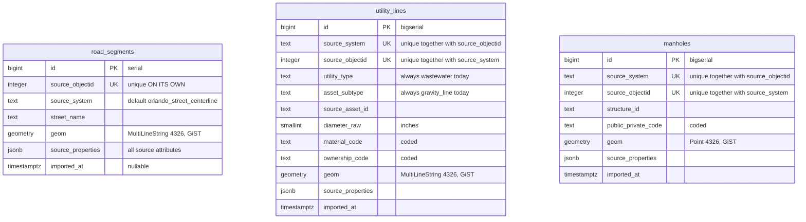
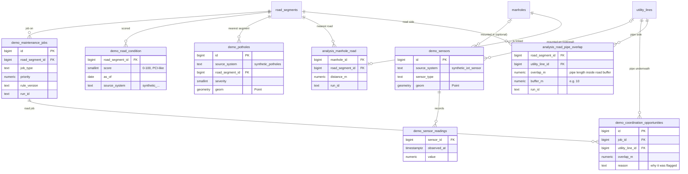
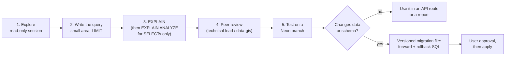

# Database Schema

Entity diagrams for the Neon PostgreSQL/PostGIS database, plus a hands-on guide
to writing SQL against it safely.

- **Column details, types, row counts and coded-value domains live in
  [data-contracts.md](data-contracts.md).** The diagrams here show structure only.
- Sources for the current model:
  - the 2026-11-16 read-only baseline recorded in data-contracts.md;
  - the `CREATE TABLE` statements in
    [load_orlando_wastewater.py:204-220](../../extractors/load_orlando_wastewater.py#L204-L220)
    and [load_orlando_manholes.py:177-190](../../extractors/load_orlando_manholes.py#L177-L190).
- **The `road_segments` DDL is not in the repository.** Its diagram is based on the
  baseline only and will be re-verified by T-52 (audit) and saved by T-53.

## 1. Current model (built): schema `public`, real data



### There are no foreign keys

The three tables are **not linked by any key**. No column in one table points to
a row in another. Today they relate **only spatially**: a pipe "belongs to" a road
only because their geometries are near each other, and that is worked out with
PostGIS functions at query time. How to document spatial relationships is in
[conventions.md § 4](conventions.md#4-spatial-relationships-are-not-foreign-keys).

That is normal for raw imported GIS layers. Each department publishes its own
layer, with its own IDs. Linking them, for example which pipes run under which
road segment, is analysis work. It's planned as separate tables (section 2), so
the real source tables stay exactly as the City publishes them.

### Why the columns look like this

- **`id` and `source_objectid`.** `id` is our own key. It is stable because upserts
  update rows in place (see [etl-workflow.md](etl-workflow.md)). `source_objectid`
  is the City's `OBJECTID`. It is how a re-run finds the same row again.
- **`source_system`** records where a row came from. That matters as soon as
  synthetic data appears: synthetic rows must use a `synthetic_` prefix (CLAUDE.md,
  Data provenance). `road_segments` is the odd one out: its unique key is
  `source_objectid` alone, so two sources with the same ID would collide (F-04,
  T-56).
- **`source_properties jsonb`** keeps every source attribute, even ones we haven't
  modelled as columns. We can promote a field to a real column later without
  re-downloading anything.
- **`geometry(…, 4326)` with a GiST index.** 4326 is longitude/latitude (WGS 84),
  which is what web maps use. The GiST index is what makes "features in this
  rectangle" fast. Units are degrees, so distances need `::geography` or a
  projected SRID (see practice query 3).

## 2. Target model: PROPOSED, NOT BUILT

> **Proposed only.** None of these schemas or tables exist. Creating them is a
> schema migration that needs user approval. The design is owned by T-60 and
> depends on the user's product decisions (read-only vs read-write, scenarios,
> IoT as snapshot or time series). Names and columns below are placeholders for
> discussion.

Mermaid entity names can't contain dots, so `demo_potholes` means table
`potholes` in schema `demo`, and `analysis_road_pipe_overlap` means table
`road_pipe_overlap` in schema `analysis`.



Questions the T-60 design has to answer:

- **Enforced or logical links into `public`?** A real foreign-key constraint from
  `demo` into `public` would block the ETL from ever deleting a source row, and it
  ties the demo to real row IDs. Logical links (a column without a constraint) are
  looser but easier to rebuild.
- **Provenance.** Anything built from a synthetic input stays in `demo` and is
  labelled synthetic (see
  [system-architecture.md § provenance](system-architecture.md#the-three-provenance-classes)).
- **Repeatable runs.** Every derived row needs a `run_id` or "as of" date, because
  the real data changes between loads.

## 3. Working with SQL like a systems architect

This is a learning guide for writing SQL against this project the way a
professional team would. **Read the whole section before running anything.**

### (a) The team workflow



- **Explore read-only first.** Look before you change anything.
- **`EXPLAIN` shows the plan without running the query. `EXPLAIN ANALYZE` runs
  it.** On a `SELECT` that is harmless. On an `UPDATE` or `DELETE`, `EXPLAIN
  ANALYZE` **really performs the write**. Never use it on a write outside a
  transaction you roll back.
- **Neon branches** are copy-on-write clones of the database. A branch is the
  right place to try a migration or a heavy query. Production stays untouched.
- **Migrations are files, not console sessions.** A schema change is a numbered
  SQL file in the repo, with forward SQL and rollback SQL, reviewed and applied
  with approval. Typing `ALTER TABLE` into a console leaves no record and can't be
  reviewed. In this project that is not allowed (CLAUDE.md, rule 2).
- **Keep real and synthetic apart.** Never `INSERT` test or made-up rows into the
  `public` tables, not even "just to try something". Use a branch, or the future
  `demo` schema.

### (b) Opening a safe session

The app and the loaders connect as the **owner role** *(2026-11-16 baseline)*, so
the database will not stop you from changing or dropping a table. A read-only
session is your own safety catch:

```sql
-- Option 1: one read-only transaction
BEGIN READ ONLY;
-- ... your SELECTs here ...
ROLLBACK;

-- Option 2: make every transaction in this session read-only
SET default_transaction_read_only = on;
```

In a read-only transaction, any `INSERT`, `UPDATE`, `DELETE` or `CREATE` fails
with `cannot execute ... in a read-only transaction`. This guards against
mistakes, not attackers: a session can switch it back off. The real protection is
a read-only role (T-57).

Where to run queries:

- **Neon console SQL Editor.** Ideally on a branch, with one of the two lines above
  first in every run. Unverified: check how the editor handles `BEGIN`/`ROLLBACK`
  before relying on option 1.
- **From Python.** `conn.read_only = True`, like
  [database/test_connection.py:13](../../database/test_connection.py#L13).
- **Never put `DATABASE_URL` on a command line** or in a file you commit
  (CLAUDE.md, rule 3).

### (c) Practice queries (read-only, graded)

> **None of these queries has been executed.** They were written from the
> documented schema and are believed to be correct, but expect to debug them.
> Reading an error message carefully and fixing the query is part of the
> exercise. Every query is a plain `SELECT`, and every one is bounded by `LIMIT`,
> a small area or a single-table aggregate. Run them inside `BEGIN READ ONLY;` …
> `ROLLBACK;`.

The examples use a small box around downtown Orlando (about 1 km across), centred
near the map's default centre
([InfrastructureMap.tsx:56](../../web/src/components/InfrastructureMap.tsx#L56)):
`ST_MakeEnvelope(-81.385, 28.535, -81.375, 28.545, 4326)`.

#### Q1. Counting and grouping (beginner)

```sql
SELECT material_code, COUNT(*) AS pipes
FROM utility_lines
GROUP BY material_code
ORDER BY pipes DESC
LIMIT 15;
```

- **Teaches:** `GROUP BY`, aggregate functions, and that `NULL` forms its own group.
- **Look for:** blank or `NULL` codes. Compare with how the stats route cleans
  them with `NULLIF(TRIM(...), '')`
  ([stats/route.ts:97](../../web/src/app/api/infrastructure/stats/route.ts#L97)).
  Can you find codes that are missing from `MATERIAL_LABELS`?

#### Q2. Exploring `jsonb` source attributes (beginner)

```sql
-- Which attribute keys does the source actually contain?
SELECT key, COUNT(*) AS rows_with_key
FROM utility_lines, jsonb_object_keys(source_properties) AS key
GROUP BY key
ORDER BY rows_with_key DESC
LIMIT 60;

-- Compare one raw attribute with the column it was copied into
SELECT source_objectid,
       source_properties ->> 'Diameter' AS diameter_raw_text,
       diameter_raw
FROM utility_lines
WHERE source_properties ? 'Diameter'
LIMIT 20;
```

- **Teaches:** `->` returns `jsonb` and `->>` returns `text`; the `?` operator
  tests whether a key exists; set-returning functions in `FROM`.
- **Look for:** is there an install-year or condition field? That would matter a
  lot for the maintenance vision. Are there fractional diameters that a
  `smallint` couldn't hold? That question is part of T-52.

#### Q3. Length in degrees vs metres (beginner–intermediate)

```sql
SELECT id, street_name,
       ST_Length(geom)                       AS length_in_degrees,
       ST_Length(geom::geography)            AS length_m,
       ST_Length(geom::geography) / 1609.344 AS length_mi
FROM road_segments
WHERE street_name = 'BOGGY CREEK RD'
ORDER BY length_m DESC
LIMIT 10;
```

- **Teaches:** why SRID 4326 lengths are meaningless in degrees, and how
  `::geography` gives metres on the earth's surface. This is the same technique
  the stats route uses
  ([stats/route.ts:81](../../web/src/app/api/infrastructure/stats/route.ts#L81)).
- **Look for:** how tiny the degree values are. Should `street_name` be matched
  exactly, or does it need `ILIKE`?

#### Q4. Nearest road to a manhole with KNN `<->` (intermediate)

```sql
SELECT m.id AS manhole_id,
       r.id AS road_id,
       r.street_name,
       ST_Distance(m.geom::geography, r.geom::geography) AS distance_m
FROM (SELECT id, geom FROM manholes ORDER BY id LIMIT 5) AS m
CROSS JOIN LATERAL (
  SELECT id, street_name, geom
  FROM road_segments
  ORDER BY road_segments.geom <-> m.geom
  LIMIT 1
) AS r;
```

- **Teaches:** `<->` is the distance operator, and `ORDER BY … <-> … LIMIT 1` can
  use the GiST index to find the nearest neighbour quickly. `LATERAL` runs the
  inner query once per outer row. The `<->` ordering is in degrees, so the true
  distance is computed afterwards in metres.
- **Look for:** typical manhole-to-centreline distances. They tell you what
  buffer width makes sense in Q6.

#### Q5. "Within N metres" with `ST_DWithin`, written to use the index (intermediate)

```sql
-- Pick a road id from Q3 or Q4 and put it in place of 12345.
SELECT COUNT(*) AS manholes_within_15m
FROM road_segments r
JOIN manholes m
  ON m.geom && ST_Expand(r.geom, 0.0003)                    -- coarse box, uses the GiST index
 AND ST_DWithin(m.geom::geography, r.geom::geography, 15)   -- exact test in metres
WHERE r.id = 12345;
```

- **Teaches:** a two-step filter. `&&` (bounding boxes overlap) is cheap and
  indexed; the exact `ST_DWithin` in metres runs only on the few candidates.
  0.0003° is roughly 30 m of latitude here, comfortably more than 15 m.
- **Look for:** remove the `&&` line, run `EXPLAIN` on both versions (Q7), and see
  what changes.

#### Q6. Buffer overlap: how much pipe runs under each road (advanced, uses CTEs)

```sql
WITH area AS (
  SELECT ST_MakeEnvelope(-81.385, 28.535, -81.375, 28.545, 4326) AS box
),
roads AS (
  SELECT r.id, r.street_name,
         ST_Transform(r.geom, 32617) AS g        -- UTM 17N: units are metres
  FROM road_segments r, area
  WHERE r.geom && area.box
  LIMIT 200
),
pipes AS (
  SELECT p.id, ST_Transform(p.geom, 32617) AS g
  FROM utility_lines p, area
  WHERE p.geom && area.box
)
SELECT roads.id AS road_id,
       roads.street_name,
       ROUND(ST_Length(roads.g)::numeric, 1) AS road_m,
       ROUND(SUM(ST_Length(ST_Intersection(pipes.g, ST_Buffer(roads.g, 10))))::numeric, 1)
         AS pipe_m_within_10m
FROM roads
JOIN pipes ON ST_DWithin(roads.g, pipes.g, 10)
GROUP BY roads.id, roads.street_name, roads.g
ORDER BY pipe_m_within_10m DESC
LIMIT 20;
```

- **Teaches:**
  - CTEs (`WITH`) for readable steps.
  - Projecting to a metre-based SRID so that `ST_Buffer(g, 10)` means 10 metres.
  - Measuring overlap instead of testing exact intersection. A road centreline and
    a parallel sewer rarely touch exactly, so `ST_Intersects` would miss them.
    This is the core idea behind dig-once analysis.
- **Look for:**
  - Roads where `pipe_m_within_10m` is close to `road_m`: likely sewer under most
    of the segment.
  - Effects of the buffer width: try 5 m and 15 m.
  - Double counting where pipes overlap each other.
  - Transforming in the CTE means the join can't use the GiST index, which is fine
    for a 1 km box and too slow citywide. At full scale this would become a
    precomputed table (section 2).

#### Q7. Reading a query plan with `EXPLAIN` (intermediate)

```sql
-- The same shape of query the /features route runs
EXPLAIN
SELECT id
FROM utility_lines
WHERE ST_Intersects(geom, ST_MakeEnvelope(-81.385, 28.535, -81.375, 28.545, 4326))
LIMIT 2000;

-- Casting the column to geography first: does the index still get used?
EXPLAIN
SELECT id
FROM utility_lines
WHERE ST_DWithin(geom::geography,
                 ST_MakeEnvelope(-81.385, 28.535, -81.375, 28.545, 4326)::geography,
                 50)
LIMIT 2000;
```

- **Teaches:** reading `Index Scan` / `Bitmap Index Scan using utility_lines_geom_idx`
  versus `Seq Scan`. A function or cast applied to the indexed column usually
  stops the index from being used.
- **Then try `EXPLAIN ANALYZE`** on the first query. Because it is a `SELECT`, it
  is safe. Compare the estimated rows with the actual rows.
- **Look for:** the index name. The `road_segments` index name is unknown until
  T-52.

#### Q8. A CTE with a window function: share of pipe length by material (intermediate)

```sql
WITH by_material AS (
  SELECT COALESCE(NULLIF(TRIM(material_code), ''), 'Not recorded') AS material,
         SUM(ST_Length(geom::geography)) / 1609.344 AS miles
  FROM utility_lines
  GROUP BY 1
)
SELECT material,
       ROUND(miles::numeric, 1) AS miles,
       ROUND((100 * miles / SUM(miles) OVER ())::numeric, 1) AS pct_of_network
FROM by_material
ORDER BY miles DESC
LIMIT 10;
```

- **Teaches:** `SUM(...) OVER ()` computes a total over all rows without
  collapsing them, which is useful for percentages.
- **Look for:** how much of the network is clay (`VCP`, `VCL`). In the vision, that
  is a real-data risk signal for dig-once.

#### Q9. Data-quality checks (intermediate)

```sql
SELECT COUNT(*)                                    AS total,
       COUNT(*) FILTER (WHERE geom IS NULL)        AS null_geom,
       COUNT(*) FILTER (WHERE NOT ST_IsValid(geom)) AS invalid_geom,
       COUNT(*) FILTER (WHERE ST_NDims(geom) > 2)  AS has_z,
       COUNT(DISTINCT ST_SRID(geom))               AS distinct_srids
FROM utility_lines;
```

- **Teaches:** `FILTER (WHERE …)` for several conditional counts in one pass.
- **Look for:** the 2026-11-16 baseline says there are no null or invalid
  geometries. Does that still hold after the next load? This is exactly what T-52
  checks for all three tables.

### (d) Where you could contribute SQL for real

Each of these is a real task on the [task board](../agents/task-board.md). Any
proposal still goes through review, and through approval if it writes.

- **T-52, the read-only database audit.** Q2, Q7 and Q9 are the beginnings of it.
  Read-only, so a good first contribution.
- **T-56, schema migrations.** Practise writing forward and rollback SQL as a
  migration file, tested on a Neon branch. Applying it needs user approval.
- **T-60, the `demo` schema design.** Turn section 2 into DDL. Q4–Q6 are prototypes
  of the analysis this schema will store.
