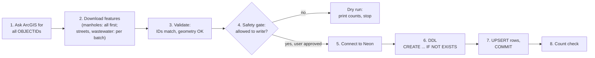
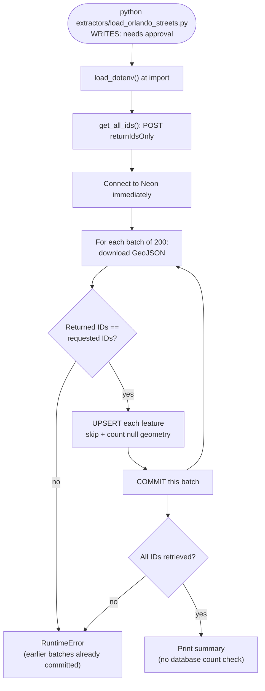
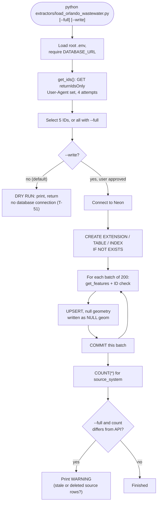
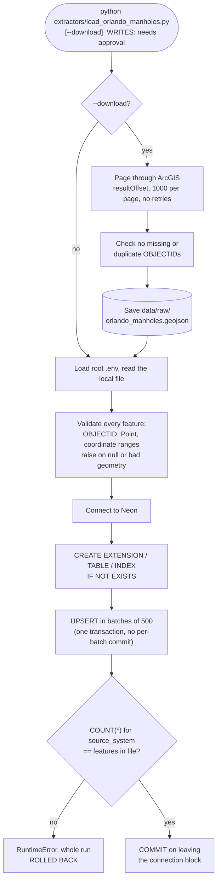
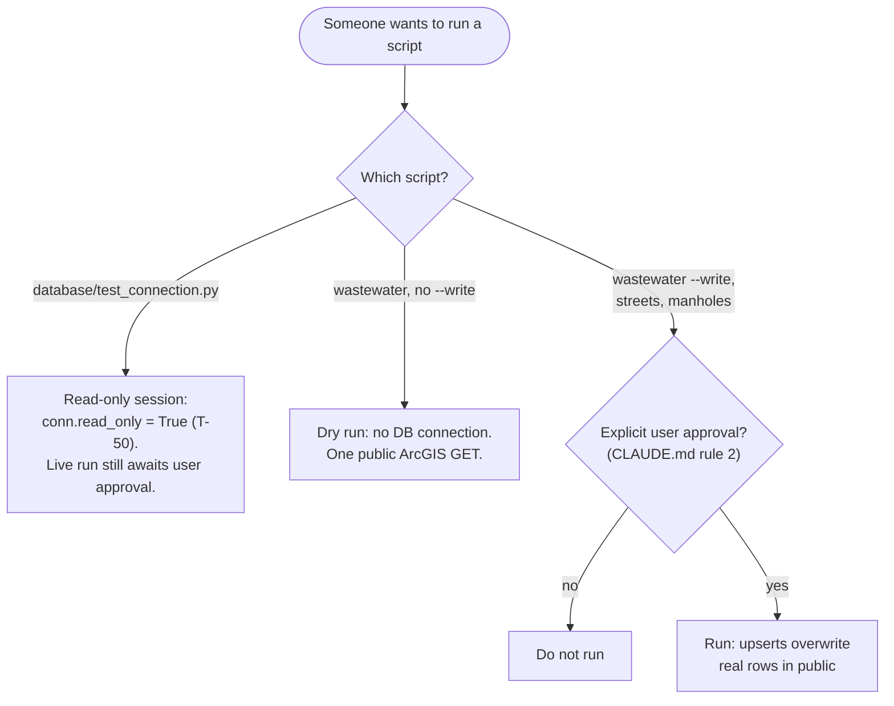

# ETL Workflow

How the three Python loaders in `extractors/` copy City of Orlando GIS data into
Neon. Drawn from the code as of 2026-11-17. Table layouts are in
[data-contracts.md](data-contracts.md) and [database-schema.md](database-schema.md),
and the overall picture is in [system-architecture.md](system-architecture.md).
Diagram rules are in [conventions.md](conventions.md); the diagrams on this page
are process diagrams, so the implementation-status legend does not apply.

> **Every loader can overwrite real rows in Neon.** Running one in a way that
> writes needs explicit user approval (CLAUDE.md, shared rule 2). Reading this
> page and the code is always safe.

## Loaders at a glance

| Loader | Source layer | Target table | Default behaviour | Writes when | Loads `.env` from |
|---|---|---|---|---|---|
| [load_orlando_streets.py](../../extractors/load_orlando_streets.py) | `services5.arcgis.com/.../Street_Centerline/FeatureServer/0`, requested as GeoJSON | `road_segments` | **Writes all records.** No flags and no dry run. Does not create the table. | Every run | `load_dotenv()` with no path ([:10](../../extractors/load_orlando_streets.py#L10)). Run as a script, it searches upward from the script's own folder and finds the root `.env`. It does not depend on the current directory (see F-10). |
| [load_orlando_wastewater.py](../../extractors/load_orlando_wastewater.py) | `gis.orlando.gov/.../PRR/Wastewater_Reclaim_Utilities/MapServer/12`, requested as Esri JSON | `utility_lines` | **Dry run** (T-51): fetches the ID list and prints counts. Makes no database connection. 5 records by default, or all with `--full`. `DATABASE_URL` must still be set (see T-55 follow-up). | Only with `--write` | Project root, explicitly ([:160-162](../../extractors/load_orlando_wastewater.py#L160-L162)) |
| [load_orlando_manholes.py](../../extractors/load_orlando_manholes.py) | `gis.orlando.gov/.../Test/Wastewater_Reclaim_Utilities__Labels__Max_Scale_1_1_000_/MapServer/1`, requested as GeoJSON | `manholes` | **Writes**, importing the local file `data/raw/orlando_manholes.geojson`. `--download` refreshes that file first. | Every run | Project root, explicitly ([:113](../../extractors/load_orlando_manholes.py#L113)) |

All three use upsert (`INSERT … ON CONFLICT … DO UPDATE`), so re-running a loader
updates rows instead of duplicating them. None of them ever deletes a row.

## The common pattern

Every loader follows the same idea, but the order differs: streets and wastewater download batch by batch while connected, and only manholes downloads everything first. Streets has no DDL, safety gate or count check.

**Why fetch IDs first?** ArcGIS services cap how many features one request
returns. Asking for the full ID list first, then requesting exact ID batches,
means the loader can prove it got every record: the set of IDs returned must
equal the set asked for. That is safer than paging with offsets, where a record
inserted mid-download can shift pages.

## Each loader in detail

### Streets → `road_segments`

Code: IDs [:44-52](../../extractors/load_orlando_streets.py#L44-L52) ·
batch check [:150-157](../../extractors/load_orlando_streets.py#L150-L157) ·
upsert with `ST_Multi` [:87-120](../../extractors/load_orlando_streets.py#L87-L120) ·
null geometry skipped [:83-85](../../extractors/load_orlando_streets.py#L83-L85) ·
per-batch commit [:163](../../extractors/load_orlando_streets.py#L163).

### Wastewater → `utility_lines`

Code: retries [:35-64](../../extractors/load_orlando_wastewater.py#L35-L64) ·
ID check [:86-122](../../extractors/load_orlando_wastewater.py#L86-L122) ·
Esri paths → MultiLineString [:125-139](../../extractors/load_orlando_wastewater.py#L125-L139) ·
dry-run gate [:188-193](../../extractors/load_orlando_wastewater.py#L188-L193) ·
connect [:195](../../extractors/load_orlando_wastewater.py#L195) ·
DDL [:197-226](../../extractors/load_orlando_wastewater.py#L197-L226) ·
commit [:295](../../extractors/load_orlando_wastewater.py#L295) ·
count and warning [:306-326](../../extractors/load_orlando_wastewater.py#L306-L326).

### Manholes → `manholes`

Code: download [:39-107](../../extractors/load_orlando_manholes.py#L39-L107) ·
validation [:133-167](../../extractors/load_orlando_manholes.py#L133-L167) ·
DDL [:172-195](../../extractors/load_orlando_manholes.py#L172-L195) ·
upsert [:199-245](../../extractors/load_orlando_manholes.py#L199-L245) ·
count check [:247-260](../../extractors/load_orlando_manholes.py#L247-L260).

**A transaction lesson in this loader.** In psycopg 3,
`with psycopg.connect(...) as conn:` commits when the block ends normally and
rolls back if an exception escapes. The manholes loader never commits per batch,
so a failed count check undoes the whole import: all or nothing. The streets and
wastewater loaders commit after every batch, so a failure halfway leaves the
earlier batches written. Neither choice is wrong. All-or-nothing is safer;
per-batch commits avoid one huge transaction. A loader should pick one on
purpose.

## Safety gates

- Only the wastewater loader has a dry-run mode so far. **Streets and manholes
  write on every run.** Adding the same dry-run default is planned as **T-61**
  (P0); see the [task board](../agents/task-board.md).
- The database role is the owner *(2026-11-16 baseline)*, so the database will
  not refuse writes. The gates above are code and process gates only.

## Known inconsistencies

Each is tracked on the [task board](../agents/task-board.md). This table is a
map, not the source of truth.

| Topic | Streets | Wastewater | Manholes | Tracked in |
|---|---|---|---|---|
| Null or bad geometry | Skips and counts it ([:83-85](../../extractors/load_orlando_streets.py#L83-L85)) | Writes a row with `NULL` geom ([:131-132](../../extractors/load_orlando_wastewater.py#L131-L132)) | Raises and stops ([:142-145](../../extractors/load_orlando_manholes.py#L142-L145)) | T-55, decision D-4 |
| Dry run | None | Default (T-51) | None | T-61 |
| DDL | None. `road_segments` DDL is not in the repo. | With `--write` | Every run | T-52, T-53, D-4 |
| Transactions | Commit per batch | Commit per batch | One transaction | T-55 |
| Count check | None (compares ID sets only) | Warns with `--full` | Rolls back on mismatch. Stale rows from earlier runs also cause a mismatch ([:247-260](../../extractors/load_orlando_manholes.py#L247-L260)). | T-55 |
| Stale rows (deleted at source) | Never removed | Never removed; warning only | Never removed; causes rollback | T-52, T-56 (`last_seen_at`), D-9 |
| HTTP | POST, 3 attempts, no User-Agent | GET, 4 attempts, User-Agent | GET, no retries, no User-Agent | T-55 |
| Unique key | `source_objectid` alone | `(source_system, source_objectid)` | `(source_system, source_objectid)` | T-52, T-56 |
| Source provenance | Public ArcGIS Online item | `PRR` folder; data-use permission to be checked (docstring) | **`Test` service folder** on a label-scale service | F-11, T-54, D-6 |
| Geometry handling | `ST_Multi` wrap | Builds a MultiLineString from Esri paths | Point. No `ST_Force2D` or `ST_IsValid` gate in any loader. | T-55 |

Also open: the T-51 dry run on 2026-11-16 reported 23,464 source IDs against
23,463 stored rows *(baseline count)*. This is unexplained until T-52 checks it.
