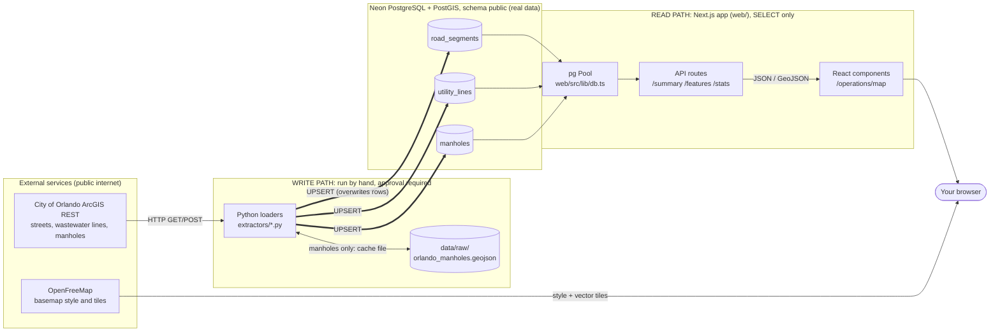
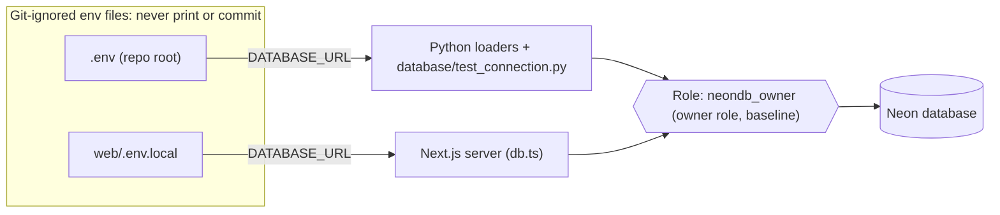
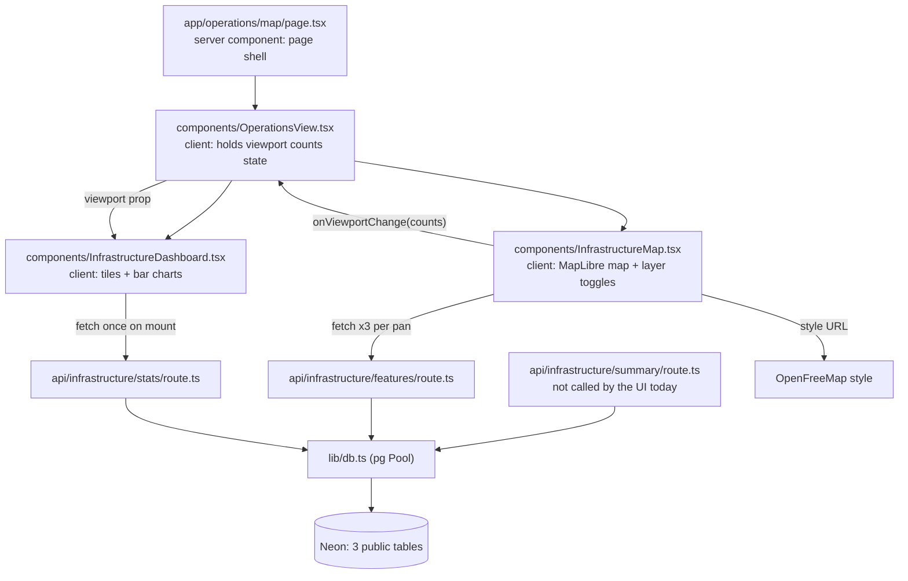
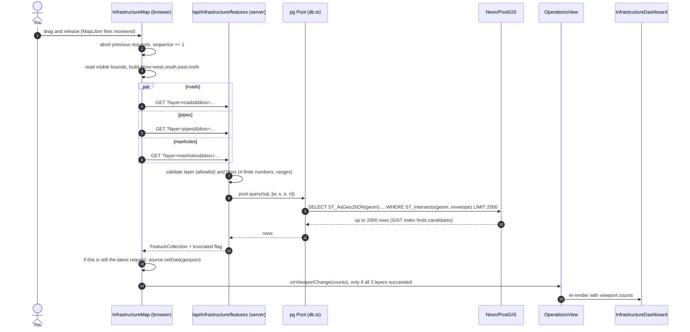
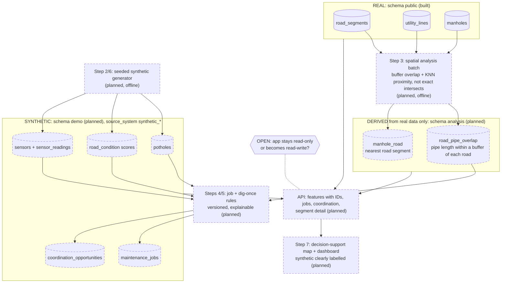

# System Architecture (diagrams)

This page is the visual map of the project: how data gets from the City of
Orlando into the database, and from the database onto the screen. It links into
the code at specific lines so you can follow along.

- Diagrams on this page were drawn from the code as of **2026-11-17**. Facts that
  come from the documented 2026-11-16 live-database baseline (row counts, versions, the
  database role) are marked *(baseline)*. They are owned by
  [system-overview.md](system-overview.md) and [data-contracts.md](data-contracts.md).
- Related pages: [etl-workflow.md](etl-workflow.md) (loaders),
  [database-schema.md](database-schema.md) (tables and SQL guide),
  [../agents/development-status.md](../agents/development-status.md) (work status).
- Diagrams use Mermaid. They render on GitHub and in VS Code with the
  "Markdown Preview Mermaid Support" extension.

## 1. Current state: the big picture

Read it left to right. **Thick arrows are writes** and need user approval
(CLAUDE.md, shared rule 2). Thin arrows are reads.

### Credential boundary

Both halves use the **same** database login, which is the owner role *(baseline)*.
The database itself would let the web app change or drop tables. Only the code
stops that, which is why T-57 proposes a read-only role
([task board](../agents/task-board.md)).

**Why the design looks like this**

- **The ETL is separate from the app.** The City's ArcGIS services are slow and
  outside our control. Copying the data into our own database once means the map
  never depends on the City's servers being up, and we can add spatial indexes
  the source doesn't give us.
- **The loaders upsert** (`INSERT … ON CONFLICT … DO UPDATE`) so a loader can be
  re-run safely. The same source record updates the same row instead of creating
  a duplicate. For example,
  [load_orlando_streets.py:106](../../extractors/load_orlando_streets.py#L106).
  The flip side is that every run overwrites rows, which is why runs need approval.
- **The browser never talks to the database.** The connection string must stay on
  the server. API routes run on the server, read `DATABASE_URL` there
  ([db.ts:4](../../web/src/lib/db.ts#L4)) and send back only JSON.
- **One shared connection pool** ([db.ts:14-20](../../web/src/lib/db.ts#L14-L20))
  reuses at most 5 open connections instead of opening a new one per request.
  Opening a connection to Neon is slow. In development the pool is stored on
  `globalThis` so hot reloads don't leak connections
  ([db.ts:22-24](../../web/src/lib/db.ts#L22-L24)).

## 2. Current state: inside the web app

- `/summary` exists and works, but no component calls it. `grep` for
  `api/infrastructure` in `web/src/components` finds only `features` and `stats`.
- **Why are the map and dashboard client components?** MapLibre draws with WebGL
  in the browser, so it can't run on the server (`"use client"` at
  [InfrastructureMap.tsx:2](../../web/src/components/InfrastructureMap.tsx#L2)). The
  page shell stays a server component.
- **Why does OperationsView hold the state?** The map knows what is on screen and
  the dashboard needs to show it. Two sibling components share data through their
  common parent ("lifting state up"):
  [OperationsView.tsx:11](../../web/src/components/OperationsView.tsx#L11) and
  [:21](../../web/src/components/OperationsView.tsx#L21).

## 3. One map pan, step by step

What happens when you drag the map and let go.

Where each step lives in the code:

| Step | Code |
|---|---|
| 1. `moveend` listener | [InfrastructureMap.tsx:205](../../web/src/components/InfrastructureMap.tsx#L205) |
| 2. Skip if style not loaded, abort the old request, bump the sequence | [:69-74](../../web/src/components/InfrastructureMap.tsx#L69-L74) |
| 3. Build the bbox | [:76-83](../../web/src/components/InfrastructureMap.tsx#L76-L83) |
| 4–6. Three parallel fetches (`Promise.all`) | [:87-93](../../web/src/components/InfrastructureMap.tsx#L87-L93) |
| 7. Validate input | [features/route.ts:17-57](../../web/src/app/api/infrastructure/features/route.ts#L17-L57) |
| 8–11. SQL with bound parameters `$1..$4` | [route.ts:59-72](../../web/src/app/api/infrastructure/features/route.ts#L59-L72) |
| 12. Response, `truncated` | [route.ts:74-86](../../web/src/app/api/infrastructure/features/route.ts#L74-L86) |
| 13. Stale-response check, `setData` | [InfrastructureMap.tsx:103-114](../../web/src/components/InfrastructureMap.tsx#L103-L114) |
| 14. Report counts only if all layers loaded | [:131-137](../../web/src/components/InfrastructureMap.tsx#L131-L137) |
| 15. Dashboard shows counts, `+` when truncated | [InfrastructureDashboard.tsx:182-196](../../web/src/components/InfrastructureDashboard.tsx#L182-L196) |

**Why it's built this way, and where it's weak**

- **Only the visible area is loaded (bbox).** The three tables hold about 62,500
  features *(baseline)*. Sending them all on every pan would be slow. The GiST
  index on `geom` lets PostGIS find the features in a rectangle without scanning
  the whole table.
- **`LIMIT 2000`** protects the server and the browser when you zoom far out.
  There is no `ORDER BY`, so which 2,000 you get is arbitrary. A count of exactly
  2,000 is reported as truncated. Both are planned fixes (T-20, T-21).
- **`AbortController` and a sequence number** guard against a race: if you pan
  twice quickly, an old slow response must not overwrite the new one.
- **The layer name is checked against an allowlist** (`tables` at
  [route.ts:5-9](../../web/src/app/api/infrastructure/features/route.ts#L5-L9))
  because table names can't be bound as SQL parameters, so they're placed into
  the SQL string directly. The allowlist is what makes that safe. The validation
  has a known gap that is being fixed under T-10.
- **Known gaps:**
  - If any one layer fails, step 14 never runs and the dashboard keeps showing
    "Loading map…" (T-40).
  - `moveend` is not debounced (T-40).

## 4. Target state: the product vision (mostly planned)

The goal is to show how a city could combine data from different departments to
plan maintenance, for example fixing a sewer pipe while the road above it is
already dug up ("dig once"). **Dashed boxes are planned and not built.** Solid
boxes exist today. Every planned part depends on decisions that are still open
(see the [vision review notes](#what-the-target-state-depends-on)).

### The three provenance classes

| Class | Where it lives | Example | Label in API and UI |
|---|---|---|---|
| Real | `public` (built) | `utility_lines` | `provenance: real` |
| Derived from real only | `analysis` (planned) | which pipes run under which road | `provenance: derived`, with method and run date |
| Synthetic, or derived from anything synthetic | `demo` (planned) | potholes, condition scores, jobs | `provenance: synthetic`, always visibly labelled |

**Rule of thumb:** if any input was synthetic, the result is synthetic. A job
generated from a fake pothole on a real road is still a fake job.

### What the target state depends on

These are open, so the diagram stays a direction, not a plan.

- **Read-only or read-write.** Do users create and approve jobs in the app (needs
  write routes, logins and a write role), or are jobs generated offline and only
  viewed? The latter keeps today's read-only API.
- **Projected geometry.** All geometry is stored in EPSG:4326, which measures in
  degrees *(baseline)*. Buffers in metres need either a `::geography` cast (slow,
  can't use the existing indexes) or a projected copy of the geometry (a schema
  migration).
- **Why not exact intersects?** A road centreline and a sewer usually run side by
  side a few metres apart, so they rarely touch exactly. Overlap within a buffer
  is the meaningful measure for dig-once. This is an engineering inference that
  T-52 and the analysis work should check against real data.
- **Design and decisions:** T-60 (the `demo` schema design) and decisions D-1 to
  D-10 on the [task board](../agents/task-board.md#decisions).

## 5. How to read the code (suggested order)

| # | Open | Look for |
|---|---|---|
| 1 | [CLAUDE.md](../../CLAUDE.md) | Who owns what, the safety rules, real vs synthetic data |
| 2 | [extractors/load_orlando_streets.py](../../extractors/load_orlando_streets.py) | The simplest loader: get IDs → download batches → upsert. Read `main()` first ([:127](../../extractors/load_orlando_streets.py#L127)), then the functions it calls. |
| 3 | [extractors/load_orlando_wastewater.py](../../extractors/load_orlando_wastewater.py) | The same pattern plus the dry-run safety gate ([:188-193](../../extractors/load_orlando_wastewater.py#L188-L193)) and table DDL. Compare it with the streets loader. |
| 4 | [database/test_connection.py](../../database/test_connection.py) | The smallest example of a read-only database session (`conn.read_only = True`, [:13](../../database/test_connection.py#L13)) |
| 5 | [database-schema.md](database-schema.md) and [data-contracts.md](data-contracts.md) | What the tables look like and what the API promises |
| 6 | [web/src/lib/db.ts](../../web/src/lib/db.ts) | 24 lines: how the server connects once and shares it |
| 7 | [web/src/app/api/infrastructure/summary/route.ts](../../web/src/app/api/infrastructure/summary/route.ts) | The simplest route: one query, JSON out, `try/catch` returning a 500 with no details |
| 8 | [.../features/route.ts](../../web/src/app/api/infrastructure/features/route.ts) | Input validation, the allowlist, a spatial query with bound parameters |
| 9 | [.../stats/route.ts](../../web/src/app/api/infrastructure/stats/route.ts) | Six queries in parallel (`Promise.all`), `GROUP BY`, code → label mapping |
| 10 | [web/src/app/operations/map/page.tsx](../../web/src/app/operations/map/page.tsx) → [OperationsView.tsx](../../web/src/components/OperationsView.tsx) | How the page is assembled and where shared state lives |
| 11 | [InfrastructureMap.tsx](../../web/src/components/InfrastructureMap.tsx) | `useEffect` setup and cleanup ([:50-216](../../web/src/components/InfrastructureMap.tsx#L50-L216)), MapLibre sources and layers, the request race guard. The hardest file, so read it last. |
| 12 | [InfrastructureDashboard.tsx](../../web/src/components/InfrastructureDashboard.tsx) | Fetch on mount with cleanup, small presentational components |

**Tip:** for each API route, open it next to its section in
[data-contracts.md](data-contracts.md#api-contracts) and check that the code does
what the contract says. That is exactly what a code reviewer does.
